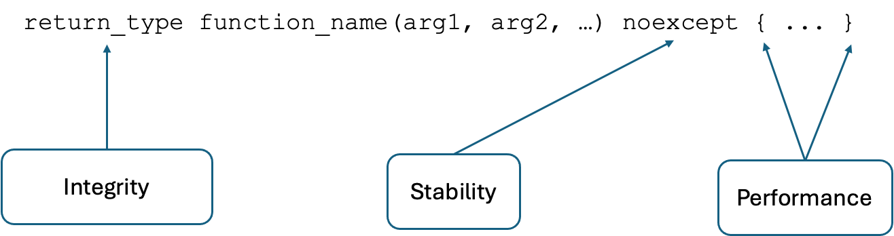

# Google Test Criteria

This repository is a mock-up for evaluating stability, integrity, and
performance criteria in a GoogleTest-based test suite.

## Three Pillars of Quality

Quality is assessed across three dimensions: integrity,
stability, and performance. Together, these pillars provide a broad view of
the test suite's quality.


## Explanation of Criteria

The diagram shows quality as the result of these three dimensions working
together: integrity, stability, and performance each contribute to the overall
assessment.



## Dependencies

The SQL output listener is included as the `gtest_output-sql` submodule. Its
nested submodules provide GoogleTest and SQLite:

```sh
git submodule update --init --recursive
```

The build also requires:

- CMake 3.16 or newer
- A C++17-capable compiler
- `make` or `gmake`
- The PostgreSQL client library and headers (`libpq`)

There is no need to add a separate GoogleTest submodule at the top level.
GoogleTest is initialized from
`submodules/gtest_output-sql/submodules/googletest`.

## Build

Configure and build the example from the repository root:

```sh
cmake -S example -B build
cmake --build build
```

This builds the `example` executable from the sources in `src/`, `include/`,
`example/`, and `submodules/gtest_output-sql/`.

### Generate an Xcode project

To generate an Xcode project instead of using the default build system:

```sh
cmake -S example -B build-xcode -G Xcode
cmake --build build-xcode --config Debug
open build-xcode/gtest_criteria_example.xcodeproj
```

## Run

Run the tests and write criteria data to a SQLite database:

    ./build/example --gtest_output=sqlite:test_results.db

To write test results to PostgreSQL, provide a libpq connection URI:

```sh
./build/example --gtest_output=postgresql://DB_HOST:5432/DB_NAME
```

To disable specific criteria checks for a run:

```sh
./build/example --criteria_disable_expect_performant
./build/example --criteria_disable_expect_integrity
```

These options can be combined with SQL output and GoogleTest arguments. Do not
commit connection URIs or credentials to source control.

The SQL schema used by the listener is stored in
`submodules/gtest_output-sql/sql/`.

Note: Disabling the stability dimension would mean disabling the test itself.
Therefore, `--criteria_disable_stability` is not available.

## License

This project is licensed under the MIT License. See [LICENSE](LICENSE) for
details.
