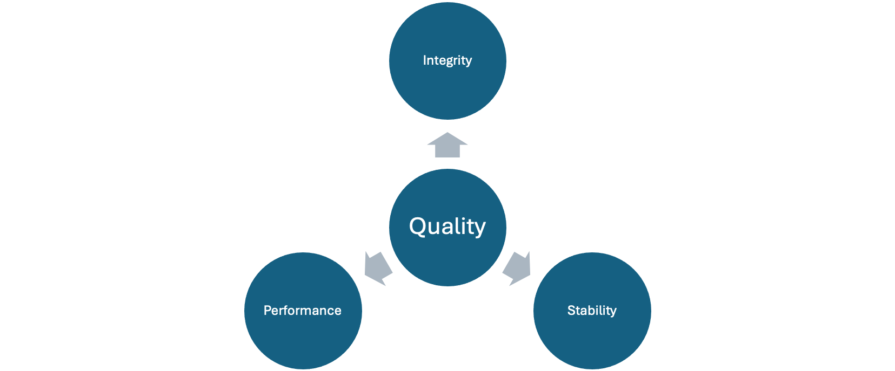

# Google Test Criteria

This repository provides the test criteria in a GoogleTest-based test suite.

## Three Pillars of Quality

Quality is assessed across three dimensions: integrity,
stability, and performance. Together, these pillars provide a broad view of
the test suite's quality.

 

* **Integrity** means that tests produce the expected results and output. It
  helps identify incorrect assertions, unexpected changes, and other signs
  that a test no longer verifies the behavior it was intended to check.
* **Stability** means that tests generally produce reliable output across
  repeated runs. It focuses on whether a test behaves dependably over time
  and helps expose flaky tests and intermittent failures, rather than whether
  every output value is identical.
* **Performance** means that tests complete within an acceptable and
  predictable amount of time. Tracking execution duration helps identify
  slowdowns and performance regressions.

## Explanation of Criteria

The diagram shows quality as the result of these three dimensions working
together: integrity, stability, and performance each contribute to the overall
assessment.


## Dependencies

The SQL output listener is included as the `gtest_output-sql` submodule. Its
nested submodules provide GoogleTest and SQLite:

```sh
git submodule update --init --recursive
```

The build also requires:

- CMake 3.16 or newer
- A C++17-capable compiler
- `make` or `gmake`
- The PostgreSQL client library and headers (`libpq`)

There is no need to add a separate GoogleTest submodule at the top level.
GoogleTest is initialized from
`submodules/gtest_output-sql/submodules/googletest`.

## Build

Configure and build the example from the repository root:

```sh
cmake -S example -B build
cmake --build build
```

This builds the `example` executable from the sources in `src/`, `include/`,
`example/`, and `submodules/gtest_output-sql/`.

### Generate an Xcode project

To generate an Xcode project instead of using the default build system:

```sh
cmake -S example -B build-xcode -G Xcode
cmake --build build-xcode --config Debug
open build-xcode/gtest_criteria_example.xcodeproj
```

## Run

Run the tests and write criteria data to a SQLite database:

    ./build/example --gtest_output=sqlite:test_results.db

To write test results to PostgreSQL, provide a libpq connection URI:

```sh
./build/example --gtest_output=postgresql://DB_HOST:5432/DB_NAME
```

### Historical test output

The other benefit of `gtest_output-sql` is that it preserves test output in a
database instead of limiting analysis to the current run. This creates a
history of test results, logged values, and execution durations that can be
compared over time. With that historical data, we can measure and monitor test
integrity and performance: detect changes in expected output, identify tests
whose behavior becomes inconsistent, and track regressions or improvements in
runtime.

To disable specific criteria checks for a run:

```sh
./build/example --criteria_disable_expect_performant
./build/example --criteria_disable_expect_integrity
```

`GetValueList<T>` return `std::optional<std::vector<T>>`. `GetValueList` returns every value logged under that name, in the order
they were logged. If no SQL database is configured, no matching value has
been logged, or the logged value cannot be parsed as `T`, they return
`std::nullopt` without recording a GoogleTest failure.

These options can be combined with SQL output and GoogleTest arguments. Do not
commit connection URIs or credentials to source control.

`EXPECT_THAT_AND_LOG(result, matcher)` accepts an
`std::optional<::testing::Matcher<T>>`, where `T` is the result type. If a
lambda produces the optional matcher from historical values, invoke it with
the logged name: `EXPECT_THAT_AND_LOG(result, matcher("result"))`. An empty
optional skips the integrity assertion but still logs the result.

The SQL schema used by the listener is stored in
`submodules/gtest_output-sql/sql/`.

Note: Disabling the stability dimension would mean disabling the test itself.
Therefore, `--criteria_disable_stability` is not available.

## License

This project is licensed under the MIT License. See [LICENSE](LICENSE) for
details.
